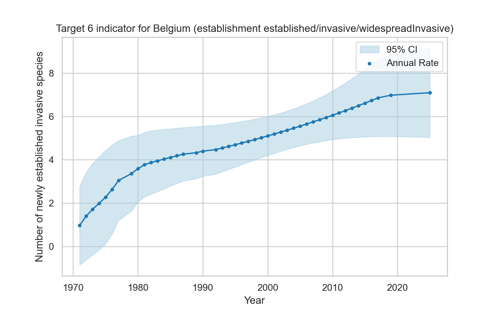
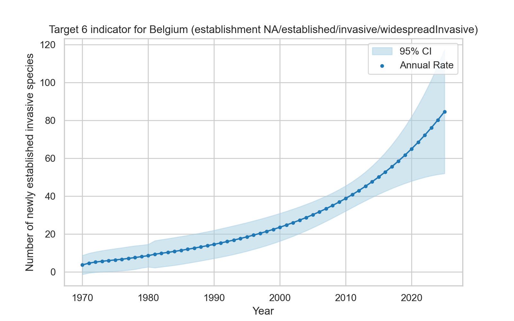
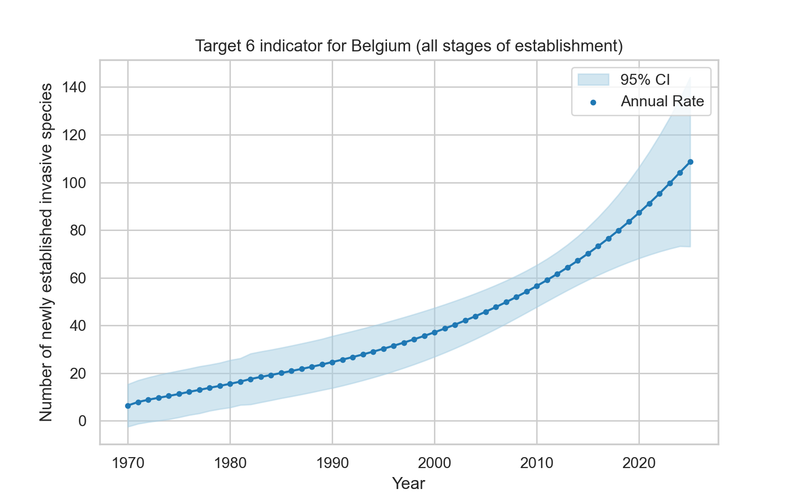

#### Indicator type

Pressure Indicator / monitoring management

#### Explanation

This indicator quantifies the number of new invasive alien species (IAS) that successfully establish within a country or region per year. The package b3alien screens occurrence records against international alien checklists to infer the establishment rate of IAS species. Furthermore, the package corrects for detection delays by applying the approach proposed by Solow and Costello, resulting in a more reliable basis for estimating IAS establishment rates.

- An increasing rate indicates that more IAS species are introduced and established in the region.

- A declining rate suggests that fewer IAS are being introduced, possibly due to effective prevention efforts targeting key introduction pathways.

#### Applicability for policy

This metric serves as the official CBD (Convention on Biological Diversity) Headline Indicator 6.1, “Rate of invasive alien species establishment”, to monitor global and national progress toward Target 6 of the Kunming-Montreal Global Biodiversity Framework. This target aims to reduce the introduction and establishment rates of known invasive species by at least 50% by 2030. Examining this indicator over longer time periods, as recommended in the CBD guidance, can provide valuable insights into the effectiveness of policies and management interventions. 

#### Limitations

This metric is highly sensitive to changes in survey effort over space and time, and differences in detectability among taxonomic groups. Consequently, this indicator should always be assessed alongside local distribution maps and expert ecological knowledge. Measures of observation effort and spatial bias are available through the b3alien package and should be considered when interpreting the results.

